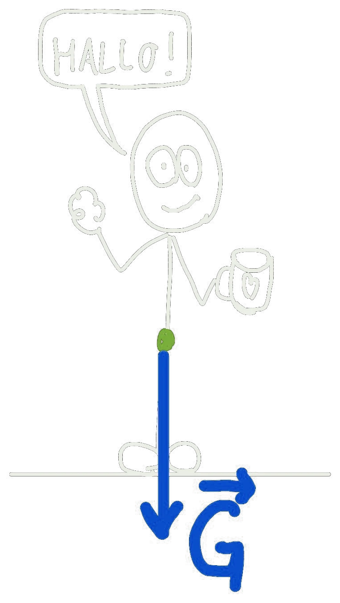
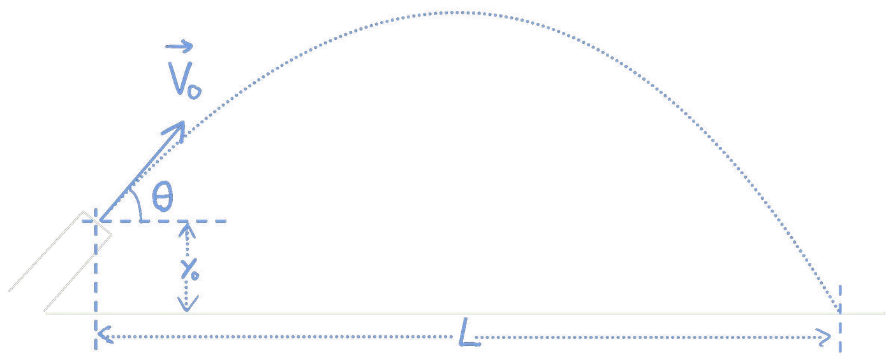
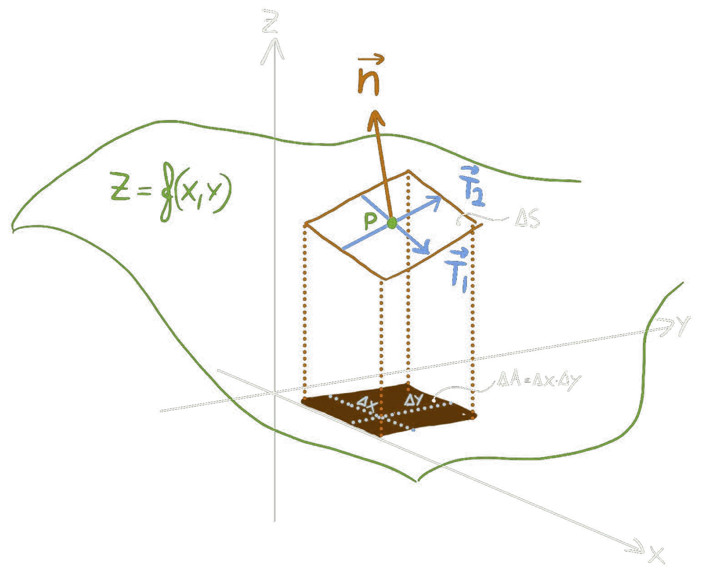
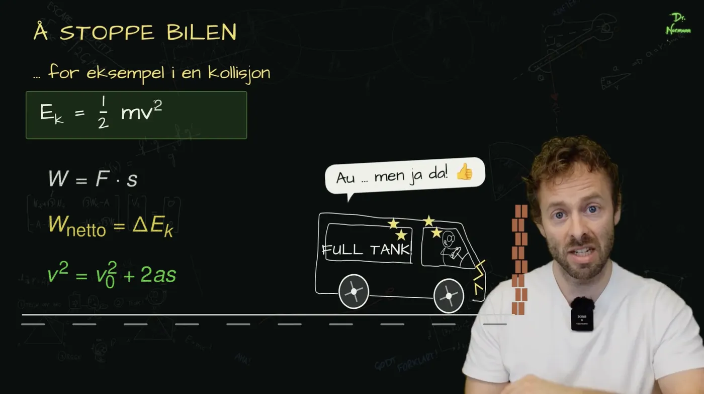
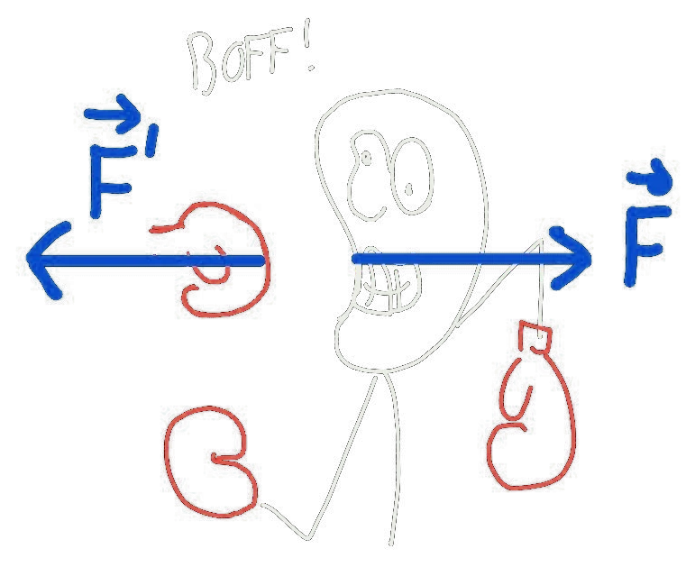
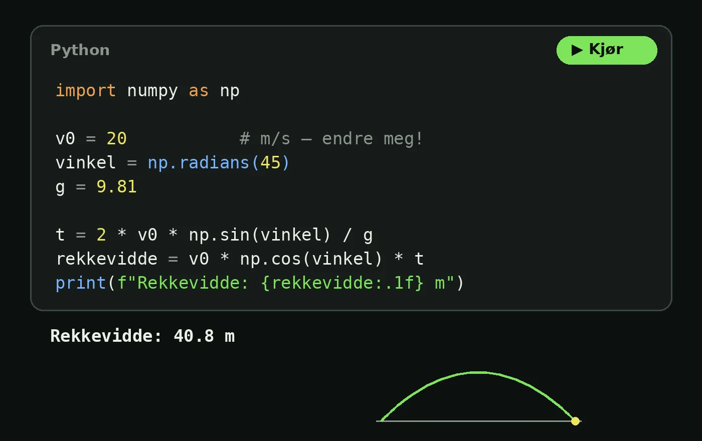
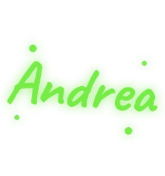

```{=html}
<section class="hero">
  <div class="hero-tekst">
    
    <p class="eyebrow">Fysikk på alle nivå!</p>
    <h1>Fysikk <span class="g">forklart</span></h1>
    <p class="lead">Korte videoer, tydelige formler, kode du kan kjøre selv og oppgaver med hint når du står fast. Laget av de som kan det best: ekte fysikere med formidlerglede!</p>
    <div class="cta">
      <a class="btn-chalk" href="fysikk-forkurs/index.html">Gå til forkurset</a>
    </div>
  </div>
  <div class="hero-scene">
    
  </div>
  <a class="soster" href="https://matematikkhjelp.no"><span>Søstersiden vår</span></a>
</section>
```

::: {.eyebrow}
Velg løype
:::

## Hvor i løypa er du?

```{=html}
<div class="tracks">
  <!-- >>> lopekort (lages av verktoy/forside.py fra fag.yml – ikke rediger mellom disse linjene) -->
  <a class="track live" href="fysikk-forkurs/index.html">
    
    <span class="status">Løype · under arbeid</span>
    <h3>Forkurs i fysikk</h3>
    <p>Fysikk fra grunnen av for deg som skal begynne på ingeniør- eller realfag. Bygger på TRES0312 ved NTNU og dekker hele forkurspensumet, med video, regneeksempler og oppgaver med hint.</p>
  </a>
  <a class="track live" href="ingeniorfysikk/index.html">
    
    <span class="status">Løype · under arbeid</span>
    <h3>Ingeniørfysikk</h3>
    <p>Mekanikk for ingeniørstudenter: kinematikk, Newtons lover, energi, bevegelsesmengde og rotasjon.</p>
  </a>
  <!-- <<< lopekort -->
  <div class="track">
    
    <span class="status">Løype · kommer på matematikkhjelp.no</span>
    <h3>Matematikk forkurs</h3>
    <p>Matematikken du trenger før ingeniør- og realfagsstudiet, i samme stil.</p>
  </div>
  <div class="track">
    
    <span class="status">Løype · kommer på matematikkhjelp.no</span>
    <h3>Matematikk for ingeniørfysikk</h3>
    <p>Derivasjon, integrasjon, vektorer og differensiallikninger, slik de brukes i ingeniørfysikken.</p>
  </div>
</div>
<div class="tracks brede">
  <a class="track live utforsk" href="tema/index.html">
    
    <span class="status">Utforsk</span>
    <h3>Alle temaer</h3>
    <p>Alt stoffet ordnet etter tema: mekanikk, fluider, termofysikk, elektromagnetisme og mer.</p>
  </a>
  <a class="track live egen" href="dekning.html">
    
    <span class="status">Din løype</span>
    <h3>Lag din egen løype</h3>
    <p>Lim inn emnebeskrivelsen til faget ditt, så finner vi sidene som passer.</p>
  </a>
</div>

<section class="slik">
  <p class="eyebrow">Slik lærer du her</p>
  <h2>Én idé om gangen</h2>
  <div class="slik-rad">
    <div><h3>Video og tavle</h3><p>Korte videoer og håndskrevne tavlenotater, akkurat som i forelesningen.</p></div>
    <div><h3>Oppgaver med hint</h3><p>Står du fast? Få et hint om gangen, ikke hele svaret.</p></div>
    <div><h3>Kode du kan kjøre</h3><p>Endre tallene og kjør Python rett i nettleseren. Ingenting å installere.</p></div>
  </div>
</section>

<a class="dekning-banner" href="dekning.html">
  
  <span class="banner-tekst"><span class="eyebrow">Nytt</span>
  <strong>Dekker vi faget ditt?</strong>
  <span>Lim inn fagets emnebeskrivelse, og få et kart over hva du finner her. →</span></span>
</a>

<section class="profiler">
  <p class="eyebrow">Våre profiler</p>
  <h2>Hvem forklarer?</h2>
  <div class="profil-rad">
    <article class="profilkort">
      <div class="profil-bilder">
        
        
      </div>
      <div>
        <h3>Dr. Normann</h3>
        <p class="profil-rolle">Ph.d. i matematisk kosmologi</p>
        <p>Jeg heter Ben, har doktorgrad i matematisk kosmologi og har formidlet og undervist realfag i ti år. I 2018 vant jeg den nasjonale finalen i Forsker Grand Prix.</p>
        <p>Her legger jeg ut forklaringene jeg selv skulle ønske jeg hadde: én idé om gangen, tegnet ut på tavla, med regning du kan følge linje for linje.</p>
      </div>
    </article>
    <article class="profilkort">
      <div class="profil-bilder">
        
        
      </div>
      <div>
        <h3>Andrea</h3>
        <p class="profil-rolle">Dobbel mastergrad</p>
        <p>Andrea har i en årrekke vært ansiktet utad og selve drivkraften i NTNU Fysikkstudio, som lager fysikkvideoer av høy kvalitet.</p>
      </div>
    </article>
  </div>
</section>

```
