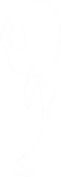
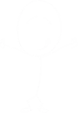
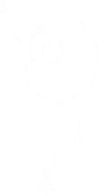
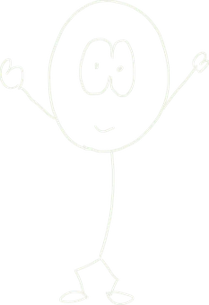
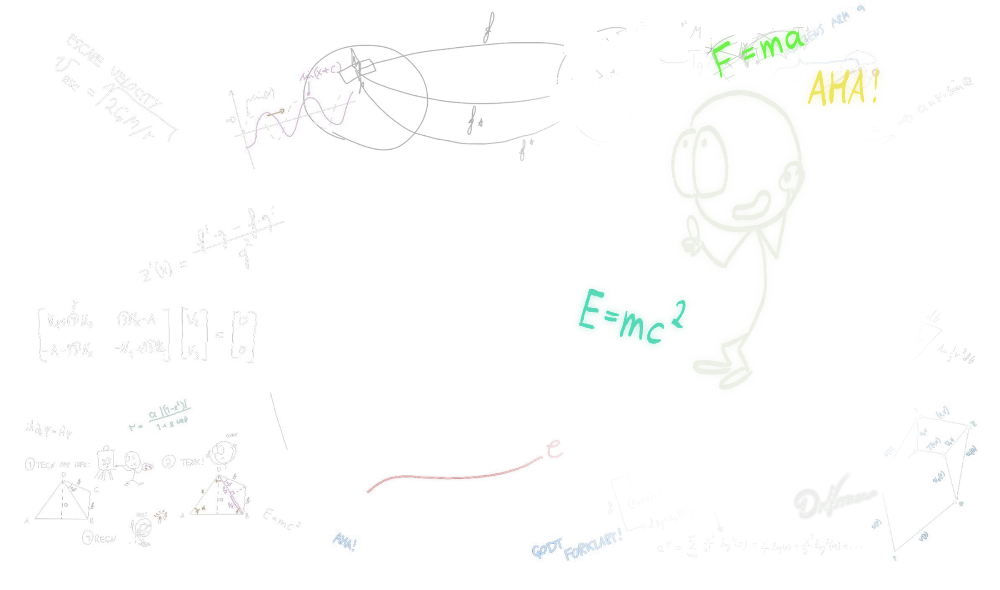
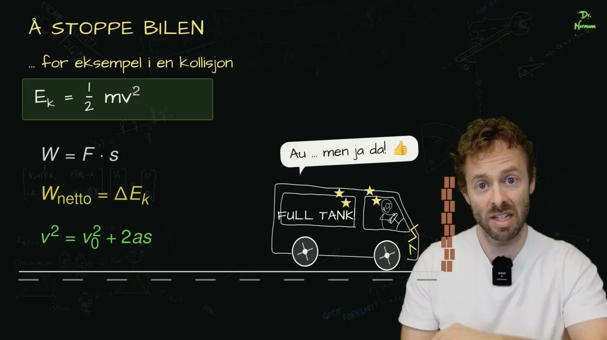
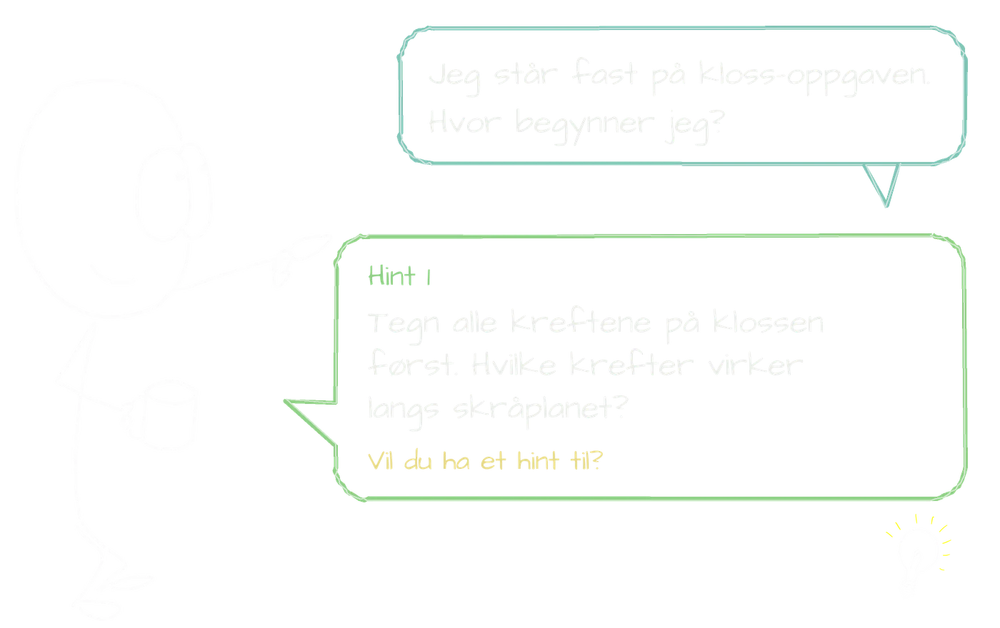
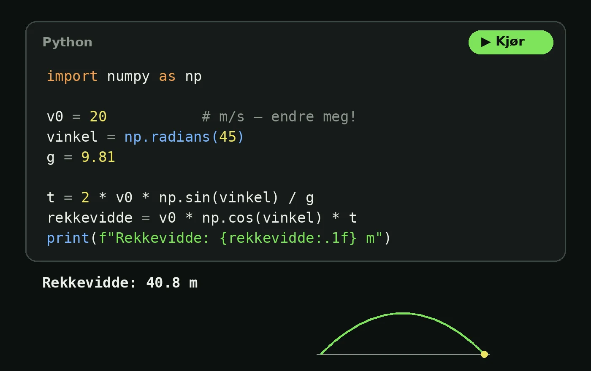
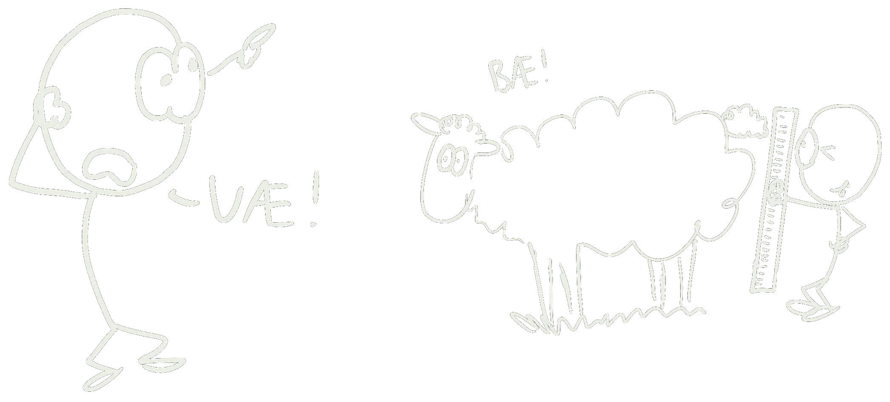

```{=html}
<section class="hero sentrert">
  <svg width="0" height="0" style="position:absolute" aria-hidden="true">
    <!-- Krittfilter: ujevn kant og små hull i streken, som kritt på tavle -->
    <filter id="kritt" x="-5%" y="-15%" width="110%" height="130%">
      <feTurbulence type="fractalNoise" baseFrequency="0.7" numOctaves="2" seed="4" result="ujevn"/>
      <feDisplacementMap in="SourceGraphic" in2="ujevn" scale="2.6" xChannelSelector="R" yChannelSelector="G" result="kant"/>
      <feTurbulence type="fractalNoise" baseFrequency="1.4" numOctaves="1" seed="9" result="korn"/>
      <feColorMatrix in="korn" type="matrix" values="0 0 0 0 0  0 0 0 0 0  0 0 0 0 0  0 0 0 -1.6 1.55" result="hull"/>
      <feComposite in="kant" in2="hull" operator="in"/>
    </filter>
  </svg>
  <div class="hero-tekst">
    <p class="eyebrow">Fysikk for forkurs og universitet!</p>
    <h1 class="kritt-tittel"><span class="k1">FORSTÅ</span> <span class="k2">fysikk</span></h1>
    <div class="kritt-ramme">
      <p class="kritt-laer">Lær med</p>
      <p class="kritt-formel"><span class="t">Video + lærebok + KI =</span> <span class="hjerte" aria-label="kjærlighet">♥</span></p>
      <p class="kritt-av"><span class="gratis">GRATIS</span>, av EKTE fysikere!</p>
    </div>
    <div class="last-ned">
      <span class="last-ned-tekst">Last ned appen</span>
      <svg class="last-ned-pil" viewBox="0 0 100 44" aria-hidden="true"><path d="M5 27 C 22 10, 40 38, 62 24 S 84 16, 90 20"/><path d="M78 9 L91 20 L77 31"/></svg>
      <a class="last-ned-knapp" href="app.html">Last ned</a>
    </div>
    <div class="velg-niva">
      <p class="velg-niva-tittel">Velg nivå!</p>
      <div class="bryter" data-pos="av">
        
        
        
        <div class="niva-knapper">
          <a class="bryter-valg" href="#niva-forkurs" data-niva="forkurs" data-nv="forkurs">Forkurs</a>
          <a class="bryter-valg" href="#niva-ingenior" data-niva="ingenior" data-nv="ingenior">Ingeniør</a>
          <a class="bryter-valg" href="#niva-fordypning" data-niva="fordypning" data-nv="fordypning">Fordypning</a>
        </div>
        <button type="button" class="bryter-knott" aria-label="Skru til neste nivå">
          <svg viewBox="-70 -70 140 140" aria-hidden="true">
            <g class="merker">
              <path d="M-62 0h-12" data-nv="forkurs"/><path d="M0 -62v-12" data-nv="ingenior"/><path d="M62 0h12" data-nv="fordypning"/>
            </g>
            <circle r="54" class="ring"/>
            <g class="riller">
              <path d="M0 -54v8M27 -46.8l-4 6.9M46.8 -27l-6.9 4M54 0h-8M46.8 27l-6.9 -4M27 46.8l-4 -6.9M0 54v-8M-27 46.8l4 -6.9M-46.8 27l6.9 -4M-54 0h8M-46.8 -27l6.9 4M-27 -46.8l4 6.9"/>
            </g>
            <circle r="38" class="topp"/>
            <g class="viser"><path d="M0 -6V-34"/><circle cy="-34" r="4"/></g>
          </svg>
        </button>
        <p class="bryter-navn">NIVÅ</p>
      </div>
    </div>
  </div>
  
  <p class="hero-dm-boble"><b>Dashman her!</b> Jeg er din personlige KI-assistent<svg class="hero-dm-hale" viewBox="0 0 46 64" aria-hidden="true"><path d="M42 2 C 36 24, 26 44, 8 62 C 18 42, 18 22, 8 2"/></svg></p>
  <div class="hero-scene">
    
  </div>
  <div class="soster">
    <p class="soster-tittel">Våre søstersider</p>
    <div class="soster-lenker"><a href="https://matematikkhjelp.no"></a><span class="snart" title="Kommer snart">kjemihjelp.no</span><span class="snart" title="Kommer snart">biologihjelp.no</span></div>
  </div>
</section>

<div class="nivaer" id="nivaer">
  <!-- >>> nivakort (lages av verktoy/tema.py fra nivaer.yml – ikke rediger mellom disse linjene) -->
  <!-- <<< nivakort -->
</div>
<script>document.documentElement.style.setProperty('--kritt-filter', 'url(#kritt)');</script>
<script>
// «Velg nivå!» som skrubryter: Forkurs til venstre, Ingeniør rett opp, Fordypning til høyre. Knotten skrus til valget,
// og bare det valgte nivået vises (så hopper siden ned til det). Uten JavaScript er valgene vanlige lenker.
(function () {
  var paneler = document.querySelectorAll('.niva-panel'), bryter = document.querySelector('.bryter');
  var REKKE = ['forkurs', 'ingenior', 'fordypning'], valgt = null;
  function vis(k, rull) {
    var p = document.getElementById('niva-' + k); if (!p) return;
    valgt = k;
    if (bryter) bryter.dataset.pos = k;
    paneler.forEach(function (x) { x.hidden = x !== p; });
    document.querySelectorAll('.niva-knapper a').forEach(function (a) { a.classList.toggle('valgt', a.dataset.niva === k); a.setAttribute('aria-current', a.dataset.niva === k ? 'true' : 'false'); });
    if (rull) setTimeout(function () { p.scrollIntoView({ behavior: matchMedia('(prefers-reduced-motion: reduce)').matches ? 'auto' : 'smooth', block: 'start' }); }, 650);
    history.replaceState(null, '', '#niva-' + k);
  }
  document.querySelectorAll('.niva-knapper a').forEach(function (a) {
    a.addEventListener('click', function (e) { e.preventDefault(); vis(a.dataset.niva, true); });
  });
  var knott = document.querySelector('.bryter-knott');
  if (knott) {
    knott.addEventListener('click', function () { vis(REKKE[(REKKE.indexOf(valgt) + 1) % 3], true); });
    knott.addEventListener('keydown', function (e) {
      var i = REKKE.indexOf(valgt);
      if (e.key === 'ArrowRight' || e.key === 'ArrowUp') { e.preventDefault(); vis(REKKE[Math.min(2, i + 1)], false); }
      if (e.key === 'ArrowLeft' || e.key === 'ArrowDown') { e.preventDefault(); vis(REKKE[Math.max(0, i < 0 ? 0 : i - 1)], false); }
    });
  }
  var m = location.hash.match(/^#niva-(\w+)/); if (m) vis(m[1], false);
})();
</script>

<section class="slik">
  <p class="eyebrow">Slik lærer du her</p>
  <h2>Én idé om gangen</h2>
  <div class="slik-rad">
    <div><h3>Video og tavle</h3><p>Korte videoer og håndskrevne tavlenotater, akkurat som i forelesningen.</p></div>
    <div><h3>Oppgaver med hint</h3><p>Står du fast? Spør Dashman, KI-assistenten vår. Han gir deg ett hint om gangen, ikke hele svaret.</p></div>
    <div><h3>Kode du kan kjøre</h3><p>Endre tallene og kjør Python rett i nettleseren. Ingenting å installere.</p></div>
  </div>
</section>

<a class="dekning-banner" href="dekning.html">
  
  <span class="banner-tekst"><span class="eyebrow">Nytt</span>
  <strong>Dekker vi emnet ditt?</strong>
  <span>Lim inn emnets emnebeskrivelse, og få et kart over hva du finner her. →</span></span>
</a>

<section class="profiler">
  <p class="eyebrow">Våre profiler</p>
  <h2>Hvem forklarer?</h2>
  <!-- >>> samlekort (lages av verktoy/samlekort.py fra ambassaden/ambassadorer.yml – ikke rediger mellom disse linjene) -->
  <div class="samlekort-rad">
    <article class="samlekort" data-farge="gronn" id="ben"><a class="sk-inni" href="https://realfagsambassaden.no/profil/ben.html" aria-label="Les om Dr. Normann"><span class="sk-flate"><span class="sk-topp"><h3 class="sk-navn">Dr. Normann</h3></span><span class="sk-bilde"></span><span class="sk-rolle">Ph.d. i matematisk kosmologi</span><span class="sk-stats"><span class="sk-stat"><b>Utdanning</b><span class="sk-verdi"><span class="sk-soyle" style="--v:95%"><i></i></span><small>Ph.d.</small></span></span><span class="sk-stat"><b>Erfaring</b><span class="sk-verdi"><span class="sk-soyle" style="--v:50%"><i></i></span><small>10 år</small></span></span><span class="sk-stat"><b>Kvalitet</b><span class="sk-verdi"><em>Engasjert</em></span></span><span class="sk-stat"><b>Fun fact</b><span class="sk-verdi"><em>Går i søvne</em></span></span><span class="sk-stat"><b>Koffein</b><span class="sk-verdi"><em class="sk-kopper">☕☕☕</em><small>3 kopper</small></span></span></span><span class="sk-bunn"><span class="sk-tilbud">Trykk for å lese mer →</span><span class="sk-nr">#001</span></span></span><span class="sk-glans" aria-hidden="true"></span></a></article>
    <article class="samlekort" data-farge="oransje" id="andrea"><a class="sk-inni" href="https://realfagsambassaden.no/profil/andrea.html" aria-label="Les om Andrea"><span class="sk-flate"><span class="sk-topp"><h3 class="sk-navn">Andrea</h3></span><span class="sk-bilde"></span><span class="sk-rolle">Dobbel mastergrad</span><span class="sk-stats"><span class="sk-stat"><b>Utdanning</b><span class="sk-verdi"><span class="sk-soyle" style="--v:85%"><i></i></span><small>Dobbel master</small></span></span><span class="sk-stat"><b>Erfaring</b><span class="sk-verdi"><em class="sk-ukjent">???</em></span></span><span class="sk-stat"><b>Kvalitet</b><span class="sk-verdi"><em>Nøyaktig</em></span></span><span class="sk-stat"><b>Fun fact</b><span class="sk-verdi"><em>Bor i Tyskland</em></span></span><span class="sk-stat"><b>Koffein</b><span class="sk-verdi"><em class="sk-kopper">☕☕☕</em><small>3 kopper</small></span></span></span><span class="sk-bunn"><span class="sk-tilbud">Trykk for å lese mer →</span><span class="sk-nr">#002</span></span></span><span class="sk-glans" aria-hidden="true"></span></a></article>
  </div>
  <!-- <<< samlekort -->
  <p class="alle-ambassadorer"><a href="https://realfagsambassaden.no/#ambassadorer">Se alle ambassadørene på Realfagsambassaden →</a></p>
</section>

<script src="assets/js/samlekort.js"></script>
```
