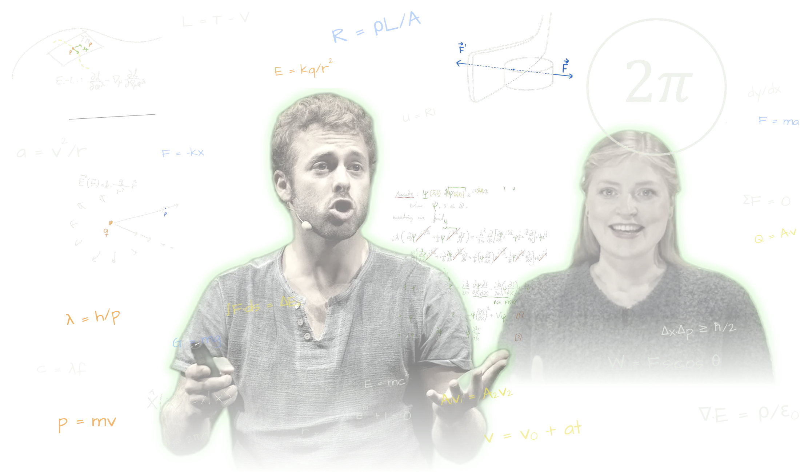

```{=html}
<section class="hero">
  <div class="hero-tekst">
    <p class="eyebrow">Fysikk på alle nivå!</p>
    <h1>Fysikk forklart <span class="g">på tavla.</span></h1>
    <p class="lead">Korte videoer, tydelige formler, kode du kan kjøre selv og oppgaver med hint når du står fast. Laget av de som kan det best: ekte fysikere med formidlerglede!</p>
    <div class="cta">
      <a class="btn-chalk" href="forkurs/index.html">Gå til forkurset</a>
    </div>
  </div>
  <div class="hero-scene">
    
  </div>
</section>
```

::: {.eyebrow}
Velg kurs
:::

## Hvor i løypa er du?

```{=html}
<div class="tracks">
  <a class="track live" href="forkurs/index.html">
    
    <span class="status">Åpent nå</span>
    <h3>Forkurs</h3>
    <p>For deg som skal begynne på ingeniør- eller realfag. Fra «hva er fysikk?» via kinematikk, krefter og energi til statikk og fluider.</p>
  </a>
  <a class="track" href="kommer/ingeniorfysikk.html">
    
    <span class="status">Kommer</span>
    <h3>Ingeniørfysikk</h3>
    <p>Fysikken i ingeniørstudiet, ordnet etter emne.</p>
  </a>
  <a class="track" href="kommer/matematikk.html">
    
    <span class="status">Kommer</span>
    <h3>Matematikk</h3>
    <p>Algebra, funksjoner, derivasjon og integrasjon, på samme måte.</p>
  </a>
  <a class="track" href="kommer/avansert-fysikk.html">
    
    <span class="status">Kommer</span>
    <h3>Avansert fysikk</h3>
    <p>For deg som vil lenger enn pensum.</p>
  </a>
</div>

<section class="slik">
  <p class="eyebrow">Slik lærer du her</p>
  <h2>Én idé om gangen</h2>
  <div class="slik-rad">
    <div><h3>Video og tavle</h3><p>Korte videoer og håndskrevne tavlenotater, akkurat som i forelesningen.</p></div>
    <div><h3>Oppgaver med hint</h3><p>Står du fast? Få et hint om gangen, ikke hele svaret.</p></div>
    <div><h3>Kode du kan kjøre</h3><p>Endre tallene og kjør Python rett i nettleseren. Ingenting å installere.</p></div>
  </div>
</section>

<a class="dekning-banner" href="dekning.html">
  
  <span class="banner-tekst"><span class="eyebrow">Nytt</span>
  <strong>Dekker vi faget ditt?</strong>
  <span>Lim inn emnebeskrivelsen til faget du skal ta eksamen i, og få et kart over hva du finner her. →</span></span>
</a>

<section class="profiler">
  <p class="eyebrow">Våre profiler</p>
  <h2>Hvem forklarer?</h2>
  <div class="profil-rad">
    <article class="profilkort">
      <div class="profil-bilder">
        
        
      </div>
      <div>
        <h3>Dr. Normann</h3>
        <p class="profil-rolle">Ph.d. i matematisk kosmologi</p>
        <p>Jeg heter Ben, har doktorgrad i matematisk kosmologi og har formidlet og undervist realfag i ti år. I 2018 vant jeg den nasjonale finalen i Forsker Grand Prix.</p>
        <p>Her legger jeg ut forklaringene jeg selv skulle ønske jeg hadde: én idé om gangen, tegnet ut på tavla, med regning du kan følge linje for linje.</p>
      </div>
    </article>
    <article class="profilkort">
      <div class="profil-bilder">
        
        
      </div>
      <div>
        <h3>Andrea</h3>
        <p class="profil-rolle">Dobbel mastergrad</p>
        <p>Andrea har i en årrekke vært ansiktet utad og selve drivkraften i NTNU Fysikkstudio, som lager fysikkvideoer av høy kvalitet.</p>
      </div>
    </article>
  </div>
</section>

```
