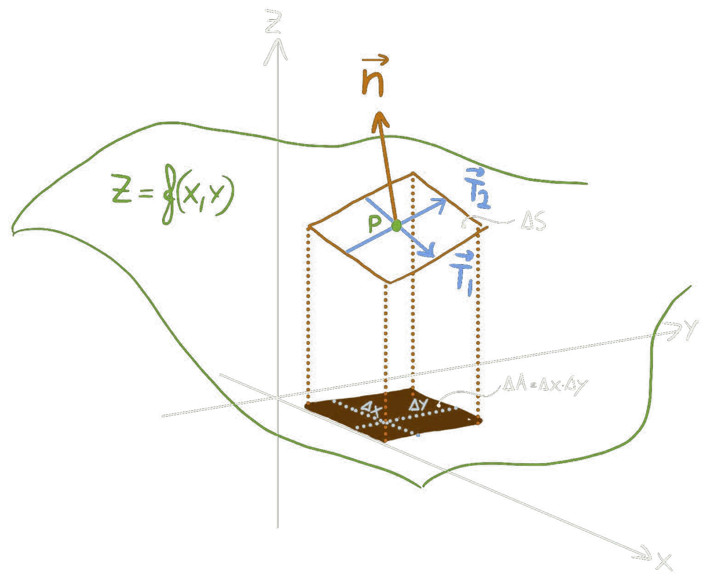

```{=html}
<div class="kommer">
  
  <p class="kommer-stor">Innhold kommer!</p>
  <p>Algebra, funksjoner, derivasjon og integrasjon, forklart på tavla på samme måte som fysikken.</p>
  <p>I mellomtiden finner du alt som er klart under <a href="../forkurs/index.html">Forkurs</a>.</p>
</div>
```
