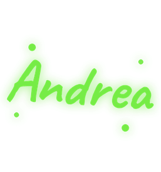
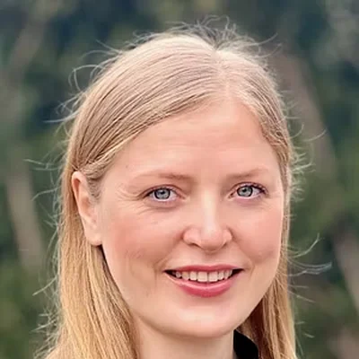

```{=html}
<section class="om-oss">
  <p class="eyebrow">Om fysikkhjelp.no</p>
  <h2>Fysikk forklart av fagfolk, gratis</h2>
  <p>fysikkhjelp.no er laget av fysikere som underviser selv. Her finner du lærebøker i forkursfysikk og ingeniørfysikk, korte videoer og håndskrevne tavlenotater, oppgaver med løsningsforslag og Dashman, KI-assistenten som gir deg ett hint om gangen i stedet for hele svaret.</p>
  <p>Studenter kan designe sin egen løype gjennom temaene, eller følge en kursløype som underviseren deres har laget. Undervisere kan bygge kurs, lage arbeidskrav og bruke stoffet som forelesningsmateriale.</p>
  <p>fysikkhjelp.no er en del av <a href="https://realfagsambassaden.no">Realfagsambassaden</a>, sammen med søstersiden <a href="https://matematikkhjelp.no">matematikkhjelp.no</a>.</p>
</section>

<section class="profiler">
  <p class="eyebrow">Våre profiler</p>
  <h2>Hvem forklarer?</h2>
  <div class="samlekort-rad">
    <article class="samlekort" data-farge="gronn">
      <a class="sk-inni" href="profiler/ben.html" aria-label="Om Dr. Normann">
        <span class="sk-flate">
          <span class="sk-topp"><span class="sk-navn">Dr. Normann</span></span>
          <span class="sk-bilde"></span>
          <span class="sk-rolle">Ph.d. i matematisk kosmologi</span>
          <span class="sk-tekst">Jeg heter Ben, har doktorgrad i matematisk kosmologi og har formidlet og undervist realfag i ti år. I 2018 vant jeg den nasjonale finalen i Forsker Grand Prix. Her legger jeg ut forklaringene jeg selv skulle ønske jeg hadde: én idé om gangen, tegnet ut på tavla, med regning du kan følge linje for linje.</span>
          <span class="sk-bunn"><span class="sk-tilbud">Mine tilbud →</span><span class="sk-nr">#001</span></span>
        </span>
        <span class="sk-glans" aria-hidden="true"></span>
      </a>
    </article>
    <article class="samlekort" data-farge="oransje">
      <a class="sk-inni" href="profiler/andrea.html" aria-label="Om Andrea">
        <span class="sk-flate">
          <span class="sk-topp"><span class="sk-navn">Andrea</span></span>
          <span class="sk-bilde"></span>
          <span class="sk-rolle">Dobbel mastergrad</span>
          <span class="sk-tekst">Andrea har i en årrekke vært ansiktet utad og selve drivkraften i NTNU Fysikkstudio, som lager fysikkvideoer av høy kvalitet.</span>
          <span class="sk-bunn"><span class="sk-tilbud">Mine tilbud →</span><span class="sk-nr">#002</span></span>
        </span>
        <span class="sk-glans" aria-hidden="true"></span>
      </a>
    </article>
  </div>
</section>
<script src="assets/js/samlekort.js"></script>
```
