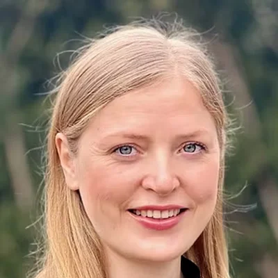
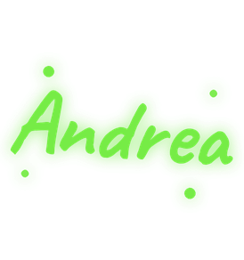

<!-- tillegg: Claude – utkast, Andrea fyller ut og retter -->

```{=html}
<div class="profilside">
  
  
</div>
```

## Om meg

Andrea har i en årrekke vært ansiktet utad og selve drivkraften i NTNU Fysikkstudio, som lager fysikkvideoer av høy kvalitet.

## Utdanning og bakgrunn

Kommer snart.

## Hva jeg brenner for

Kommer snart.

## Erfaring

- Dobbel mastergrad
- NTNU Fysikkstudio: fysikkvideoer av høy kvalitet

## Mine tilbud

Andreas kurs kommer snart.

## Følg meg

<!-- Fyll inn lenkene. Tomme lenker vises ikke. -->

```{=html}
<div class="sosiale">
  <a class="sosial" data-p="youtube" href="">YouTube</a>
  <a class="sosial" data-p="instagram" href="">Instagram</a>
  <a class="sosial" data-p="tiktok" href="">TikTok</a>
  <a class="sosial" data-p="facebook" href="">Facebook</a>
  <a class="sosial" data-p="linkedin" href="">LinkedIn</a>
  <a class="sosial" data-p="nettside" href="">Nettside</a>
  <a class="sosial" data-p="epost" href="">E-post</a>
  <p class="sosiale-tom">Lenker kommer.</p>
</div>
```

## Foredrag, skolebesøk og privatundervisning

Du kan booke privatundervisning, eller invitere meg til skolebesøk, show og andre arrangementer, gjennom [Realfagsambassaden](https://realfagsambassaden.no).
